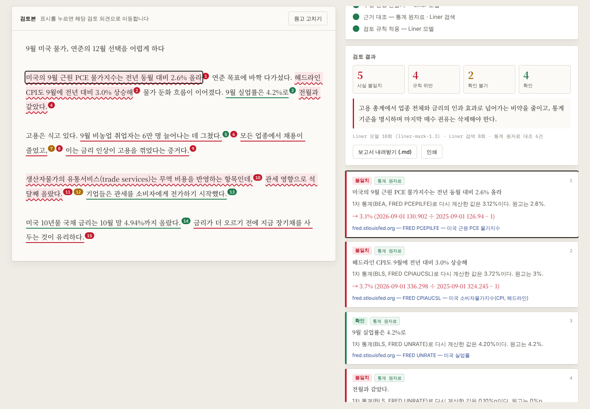

# Redline — 보고서가 나가기 전, 선임의 마지막 검토

원고를 넣으면 ① 확인할 주장을 뽑아 원장을 만들고 ② 수치는 통계 원자료(FRED)로 다시 계산해 대조하고,
그 밖의 사실은 Liner 검색으로 출처를 찾아 대조한 뒤 ③ 실제 실수에서 나온 검토 규칙으로 빨간 줄을 긋는다.

> 라이너 .EXE-THON 2026 출품작 (개발 중). 실행 방법·Liner API 사용 지점·기존/신규 구분은 제출 전에 이 문서에 정리한다.

## 빠른 실행

```bash
python -m venv .venv && .venv/bin/pip install -r requirements.txt
cp .env.example .env        # LINER_API_KEY 만 채운다 (다른 유료 키 불필요)
.venv/bin/uvicorn redline.server:app --port 8765     # 웹 화면: http://localhost:8765
.venv/bin/python -m redline review samples/us-inflation-oct.md   # 명령줄
.venv/bin/python -m pytest -q tests
```



규칙 묶음을 바꾸면 같은 엔진이 다른 문서를 검토한다(`rulepacks/research.yaml` 12개, `rulepacks/proposal.yaml` 6개).
`samples/`의 원고는 시연용으로 일부러 오류를 넣은 가상 원고다.

## 얼마나 잡는가 — 오류 심기 실험

통계 원자료로 참인 문장을 만들고 그 사이에 오류를 심은 원고 16편을 돌린 결과다(2026-11-20 실행, 전문은 [`eval/RESULTS.md`](eval/RESULTS.md)).

| 심은 것 | Redline | 같은 모델에 원고만 준 경우 |
|---|---|---|
| 수치 오기·기준 혼동 | 24/24 | 0/24 |
| 제도·정의 오류 | 8/8 | 8/8 |
| 규칙 위반 문장 | 24/24 (규칙 번호 일치 19) | 24/24 |
| 참인 문장을 틀렸다고 짚음 | 0/32 | 0/32 |
| 참인 문장에 군더더기 지적 | 0/24 | 7/24 |

모델은 올해 9월 물가가 몇 %였는지 모른다. 숫자는 통계 원자료로 다시 계산해야 잡힌다 — 이 실험이 보여 주는 것은 그 차이다.
오류를 심은 사람과 도구를 만든 사람이 같고, 심은 수치는 통계 목록 안의 지표다. 한계는 `eval/RESULTS.md`에 적었다.

```bash
.venv/bin/python eval/build.py   # 원고와 정답표 다시 만들기 (FRED)
.venv/bin/python eval/run.py     # 실행·채점 (약 4분, Liner 모델 약 80회·검색 약 50회)
```

## Liner API를 쓰는 곳

| 단계 | API | 파일 |
|---|---|---|
| 주장 원장 추출, 근거 판정, 규칙 검토 | Liner Model API (`liner-mark`, Chat Completions) | `redline/liner.py`, `redline/pipeline.py` |
| 통계 목록에 없는 사실의 출처 찾기 | Liner Search API (웹·학술) | `redline/liner.py` |

수치 대조에 쓰는 FRED 공개 CSV는 키가 필요 없다.
